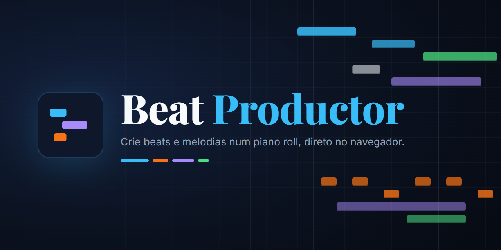

<p align="center">
  
</p>

<p align="center">
  
  
  
  
  
  
  
  
  <br>
  
  
  
  
</p>

<p align="center">
  <a href="docs/MANUAL_DE_USO.md"><b>Manual de uso</b></a> ·
  <a href="docs/especificacao/requisitos.md"><b>Requisitos</b></a> ·
  <a href="docs/especificacao/especificacao-mvp.md"><b>Especificação</b></a> ·
  <a href="docs/API.md"><b>API</b></a> ·
  <a href="docs/DIARIO_DE_CODIFICACAO.md"><b>Diário de codificação</b></a>
</p>

---

## O que é o Beat Productor

O **Beat Productor** é um aplicativo web para **montar beats e melodias rapidamente** num grid estilo
*piano roll*. Cada linha é uma nota (3 oitavas, de C3 a B5) e cada coluna é um pedaço de tempo. Você clica para
criar notas, ouve na hora pelo navegador e exporta o resultado em **MP3**.

- **4 instrumentos sintetizados:** Piano Acústico, Bateria (17 peças: bumbo, caixa, chimbal, surdo, tom 1, tom 2, ride, prato de ataque, splash, china, stack, bell, octobans, rototons, cowbell, jam block e pandeirola), Lofi Synth e Lead Synth.
- **Pensado para quem lê partitura:** fórmula de compasso (2/4 a 12/8), células com o nome da figura
  (semínima, colcheia, semicolcheia, tercinas) e BPM em semínimas, como no metrônomo.
- **Edição completa:**
  - desenhar, selecionar com retângulo, **unir** e **separar** notas (ligaduras);
  - **pausas**;
  - mover a seleção arrastando ou com as setas;
  - **Ctrl+C / Ctrl+V**;
  - **Ctrl+Z** desfaz e **Ctrl+Y** refaz.
- **Mixer** com volume por instrumento, já calibrado para soar equilibrado, com limitador que impede distorção.
- **Loop** sem cortes entre as repetições, tanto no navegador quanto no MP3 exportado.
- **Arquivo de projeto em texto:** exporte, edite à mão (ou escreva uma música inteira) e importe de volta, exatamente igual.
- **Salvamento automático** no navegador.

## Documentação

| Documento | Conteúdo |
|---|---|
| 📘 [Manual de uso](docs/MANUAL_DE_USO.md) | Como usar cada recurso, atalhos, formato do arquivo de projeto, problemas comuns |
| 📝 [Requisitos](docs/especificacao/requisitos.md) | Requisitos originais do projeto |
| 📐 [Especificação do MVP](docs/especificacao/especificacao-mvp.md) | Escopo, fases e critérios de aceite |
| 🔌 [API](docs/API.md) | Contrato do `POST /api/export` e do `GET /api/health` |
| 📓 [Diário de codificação](docs/DIARIO_DE_CODIFICACAO.md) | Decisões, problemas encontrados e verificações de cada etapa |

## Instalação e uso

### Requisitos

- **Python 3.12, 3.13 ou 3.14 (64 bits).** No Windows, o `BeatProductor.exe` instala um sozinho se o computador não tiver (sem administrador, sem mexer no PATH)
- Um navegador moderno (Chrome, Edge ou Firefox) com internet (o Tailwind é carregado via CDN)
- Para rodar os testes: **Node.js 21+** e **Chrome ou Edge**

### Baixar

```bash
git clone https://github.com/ikuyorih9/BeatProducer.git
cd BeatProducer
```

### Executar

**Windows (jeito fácil):** dê dois cliques em **`BeatProductor.exe`**, na raiz do projeto. O lançador:
- encontra um Python compatível ou, se não houver, baixa o instalador oficial do python.org, confere o hash e instala um Python só para o app;
- prepara o ambiente na primeira vez;
- escolhe uma porta livre e sobe o servidor;
- abre o navegador.

Para encerrar, feche a janela. Opções de linha de comando: `--port N`, `--no-browser`, `--no-pause`, `--install-python`.

**Pelo terminal:**

```powershell
# Windows (PowerShell)
powershell -ExecutionPolicy Bypass -File scripts\run.ps1
```

```bash
# Linux / macOS / Git Bash
scripts/run.sh
```

Abra **http://127.0.0.1:8000**. Na primeira execução o script cria o `.venv` e instala as dependências.

### Primeiros passos

1. Escolha um **Instrumento** e clique no grid para criar notas. Arraste para fazer notas longas.
2. Aperte **▶ PLAY** (ou **Espaço**).
3. Marque **Loop**, escolha quantas repetições e clique em **Exportar MP3**.

O passo a passo completo está no [Manual de uso](docs/MANUAL_DE_USO.md).

### Testes

```powershell
powershell -ExecutionPolicy Bypass -File scripts\test.ps1   # ou: scripts/test.sh
```

| Suíte | Quantidade |
|---|---|
| Backend (pytest) | 155 testes |
| Frontend (`node:test`) | 109 testes |
| E2E (Chrome/Edge headless) | 44 verificações |

O E2E abre o app num navegador real e testa com cliques, arrastes e teclas de verdade. Ele confere também o
áudio sintetizado (equilíbrio, ausência de distorção) e uma exportação MP3 completa.

## Tecnologias

| Camada | Tecnologias |
|---|---|
| **Frontend** | HTML5, Tailwind CSS (CDN), JavaScript puro em **ES Modules** (sem build, sem dependências) e **Web Audio API**: síntese dos instrumentos, agendador com *lookahead*, mixer e limitador |
| **Backend** | **Python** + **FastAPI** + Pydantic (contrato JSON); **NumPy/SciPy** para a síntese e a mixagem; **lameenc** para o MP3 |
| **Testes** | pytest, `node:test` e um E2E próprio que controla o Chrome/Edge headless pelo **Chrome DevTools Protocol** (sem Puppeteer/Playwright) |
| **Lançador** | **C#** compilado com o `csc.exe` do .NET Framework que já vem no Windows (`launcher/`) |

## Estrutura do projeto

```
BeatProducer/
├── BeatProductor.exe         # Lançador para Windows (duplo clique)
├── frontend/                 # Interface (servida como arquivos estáticos)
│   ├── index.html
│   ├── css/styles.css
│   ├── js/
│   │   ├── main.js           # Ponto de entrada: liga estado, UI, áudio e transporte
│   │   ├── config.js         # Constantes (ticks, figuras, compassos, instrumentos, calibração)
│   │   ├── core/             # Lógica pura, sem DOM (testável no Node)
│   │   │   ├── music.js      #   notas, MIDI, frequências, bateria
│   │   │   ├── timing.js     #   ticks ↔ segundos, figuras, compassos
│   │   │   ├── layout.js     #   geometria do grid
│   │   │   ├── sequence.js   #   notas e pausas: unir, separar, mover, fim da música
│   │   │   ├── selection.js  #   seleção, limites do arraste, copiar/colar
│   │   │   ├── transport.js  #   relógio musical (play/pause/seek/loop)
│   │   │   ├── schedule.js   #   notas numa janela de tempo (agendamento)
│   │   │   ├── export.js     #   pedido de exportação + pré-validação
│   │   │   ├── project.js    #   projeto salvo no navegador (versões e migração)
│   │   │   ├── project-file.js#  arquivo de projeto em texto (exportar/importar)
│   │   │   ├── volume.js     #   curva perceptiva do mixer
│   │   │   └── store.js      #   estado da aplicação
│   │   ├── audio/            # Web Audio API: motor, instrumentos, agendador
│   │   ├── services/         # Backend (exportação) e salvamento automático
│   │   └── ui/               # Componentes de interface
│   ├── tests/                # Testes unitários (node:test)
│   └── package.json          # Só scripts de teste, sem dependências
├── backend/                  # API Python (FastAPI), que também serve o frontend
│   ├── app/
│   │   ├── main.py           # Aplicação + arquivos estáticos
│   │   ├── schemas.py        # Contrato JSON (Pydantic)
│   │   ├── api/routes.py     # /api/health e /api/export
│   │   ├── audio/            # Síntese, mixagem com loops (overlap-add), WAV/MP3
│   │   └── core/             # Configuração, calibração e teoria musical
│   └── tests/                # Testes pytest
├── launcher/                 # Código do lançador (C#), ícone e script de build
├── tests/e2e/                # Teste ponta a ponta em navegador headless (CDP)
├── scripts/                  # run.ps1/.sh (executar) e test.ps1/.sh (testar tudo)
└── docs/                     # Manual, requisitos, especificação, API, diário e o banner (assets/)
```

## Roadmap

- [x] **Fase 1:** estrutura base, grid de 3 oitavas e cursor de reprodução
- [x] **Fase 2:** Web Audio API (reprodução local)
- [x] **Fase 3:** backend Python e síntese
- [x] **Fase 4:** exportação MP3 e ajustes finais
- [x] Lançador `.exe` para Windows
- [x] Unir/separar notas, pausas e fim da música
- [x] Copiar/colar, mover a seleção, Limpar tudo
- [x] Compassos e figuras da partitura, arquivo de projeto, mixer calibrado

## Licença

Distribuído sob a licença **MIT**. Veja [LICENSE](LICENSE).

---

> [!NOTE]
> O **Beat Productor** foi planejado e projetado por **Hugo Hiroyuki Nakamura** e implementado pelo
> **Claude Opus 5.5** (Anthropic), via [Claude Code](https://claude.com/claude-code).

<sub>O banner é gerado a partir de <code>docs/assets/banner.html</code> com <code>node docs/assets/render-banner.mjs</code>.</sub>
